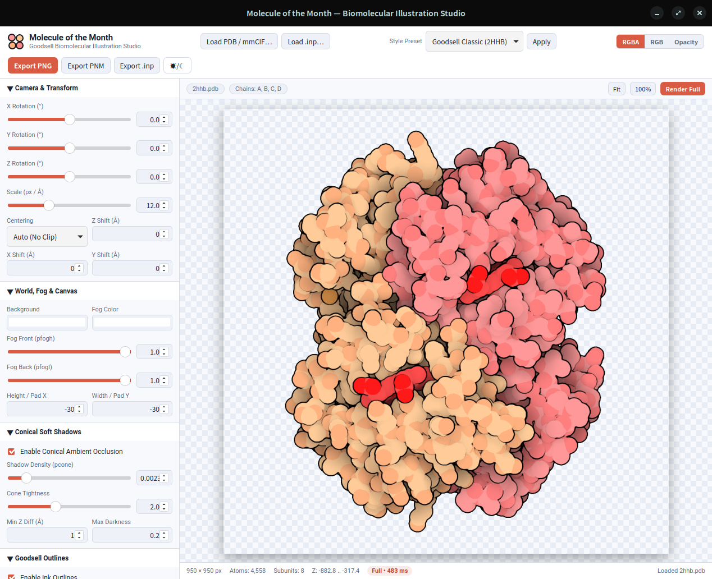

[](https://opensource.org/licenses/Apache-2.0)

# I L L U S T R A T E



> Biomolecular Non-Photorealistic Illustration (Rust Edition)

Original Fortran implementation copyright 2019 David S. Goodsell.  
Licensed under the Apache License, Version 2.0 (the "License"); you may not use this file except in compliance with the License. You may obtain a copy of the License at http://www.apache.org/licenses/LICENSE-2.0.

This work was supported in part by Damon Runyon-Walter Winchell Cancer Research Fund Fellowship DRG 972, the US National Institutes of Health R01-GM120604 and the kind support of the RCSB Protein Data Bank.  
DS Goodsell & AJ Olson (1992) *"Molecular Illustration in Black and White"* JMolGraphics 10, 235-240.  
April 2019: Simplified and released with only non-photorealistic rendering.  
Rewritten in modular, memory-safe Rust with pixel-exact parity against `legacy/illustrate.f`.

---

## Project Structure

```text
Illustrate-mom/
├── .github/workflows/ci.yml   # GitHub Actions CI (fmt, clippy, unit & Fortran parity tests)
├── crates/
│   └── illustrate-gui/        # Tauri v2 desktop studio ("Molecule of the Month")
├── docs/adr/                  # Architecture Decision Records
├── examples/                  # Sample Hemoglobin (2HHB) command deck & PDB structure
├── legacy/                    # Original illustrate.f preserved for parity verification
├── src/
│   ├── lib.rs                 # Public library pipeline API
│   ├── main.rs                # CLI binary (supports stdin & modern flags)
│   ├── command.rs             # Command card parser & .inp script serializer
│   ├── pdb.rs                 # PDB reader, AtomDescriptor matching, BIOMT & subunit assignment
│   ├── presets.rs             # Signature "Molecule of the Month" Goodsell color presets
│   ├── transform.rs           # 4x4 matrix concatenation, Euler angles & coordinate transforms
│   ├── framebuffer.rs         # Dynamic padded 2D frame buffer
│   ├── render.rs              # Spherical Z-buffer rasterizer, conical shadows, fog & outlines
│   ├── pnm.rs                 # Netpbm P3 PPM & RGBA PNG writers
│   └── error.rs               # Structured error types
├── tests/                     # Integration parity tests against gfortran
├── Cargo.toml
├── GLOSSARY.md                # Domain glossary
└── LICENSE
```

---

## Building and Running

### Prerequisites
- Rust toolchain (`cargo`, `rustc`)
- *(Optional, for legacy parity test)* `gfortran`

### Build & Test

```bash
cargo build --release --workspace
cargo test --workspace
```

### Launch Desktop GUI ("Molecule of the Month")

```bash
cargo run -p illustrate-gui --release
```

Features include clean empty-state startup, dual **PDB** (`.pdb`/`.ent`) and **mmCIF** (`.cif`/`.mmcif`) coordinate loading, interactive drag-to-rotate with fast preview, wheel zoom/pan, **Molecule of the Month** color presets (*Goodsell Classic*, *Subunit Pastel*, *1992 Monochrome Ink*, *CPK Soft*), collapsible `AtomDescriptor` rules and bidirectional `.inp` command deck accordions, RGBA/RGB/Opacity layer switching, and PNG/PNM/`.inp` export.

### Releasing Desktop GUI via GitHub Actions

Pushing a version tag matching `v*` triggers [release.yml](.github/workflows/release.yml), which builds bundled **Molecule of the Month** installers across Linux (`ubuntu-22.04`), macOS (`universal-apple-darwin`), and Windows (`windows-latest`) and attaches them to a GitHub Release:

```bash
git tag v0.1.0
git push origin v0.1.0
```

### Run CLI via Standard Input (Legacy Compatible)

```bash
cargo run --release < examples/2hhb.inp
```

### Run with Modern CLI Options

```bash
# Pass script path directly and export an RGBA PNG alongside PPM outputs
cargo run --release -- examples/2hhb.inp --output 2hhb.pnm --png 2hhb.png

# Inspect all CLI flags
cargo run -- --help
```

Relative PDB filenames inside legacy command decks (such as `2hhb.pdb` in `examples/2hhb.inp`) are automatically resolved across `CWD -> script directory -> examples/`.

## Command File Format

The command file has command cards (`read`, `center`, `translate`, `xrot`, `yrot`, `zrot`, `scale`, `world`, `illustrate`, `calculate`), followed by parameter cards needed for each command. Issue command cards in this order:

1. `read` — reads coordinates and selection/rendering parameters
2. `center`, `translate`, `xrot`, `yrot`, `zrot`, `scale` — in any order
3. `world` — defines rendering, fog, shadow, and canvas parameters
4. `illustrate` — defines contour, subunit, and residue outline parameters
5. `calculate` — renders the image and writes the PPM file (plus `opacity.pnm`)

Selection/rendering cards in the `read` command are read sequentially until `END` (or a non-`ATOM`/`HETATM` termination line) is found. Atoms are compared to cards in order, and the first match assigns the atom's color and radius. Any number of rotation cards may be added and are concatenated effectively last-to-first. Rotations are applied first, then centering, and finally translation. Origin is at upper left, `+x` down, `+y` left to right, `+z` towards viewer, and molecules are clipped at `z = 0`.

## Command Card Reference

- **`READ`**: PDB filename, followed by selection/rendering cards (`record_name[6]`, `atom_descriptor[10]` with `-` wildcard, `res_low`, `res_high`, `r`, `g`, `b`, `radius`; `radius = 0.0` omits matching atoms).
- **`CENTER`**: `auto` (autocenter without clipping at `z = 0`) or `center` (center on min/max x, y, z).
- **`TRANSLATE`**: `x, y, z` translation in Angstroms.
- **`XROT`, `YROT`, `ZROT`**: rotation angle in degrees.
- **`SCALE`**: scale value in pixels/Angstrom.
- **`WORLD`**:
  - Line 1: `rback[3]`, `rfog[3]`, `pfogh`, `pfogl` (`0.0–1.0`, `1.0` = no fog)
  - Line 2: `icone` (`0` off / non-zero on), `pcone`, `coneangle`, `rcone`, `pshadowmax`
  - Line 3: `ixsize`, `iysize` (negative values trigger autosizing with padding)
- **`ILLUSTRATE`**:
  - Line 1: `l_low`, `l_high`, `ikernel` (`1..=4`), `l_diff_min`, `l_diff_max`
  - Line 2: `r_low`, `r_high` (subunit outlines)
  - Line 3: `g_low`, `g_high`, `resdiff` (residue outlines)
- **`CALCULATE`**: Output PPM filename.
